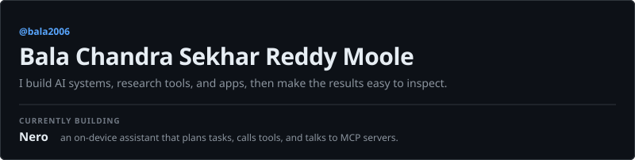
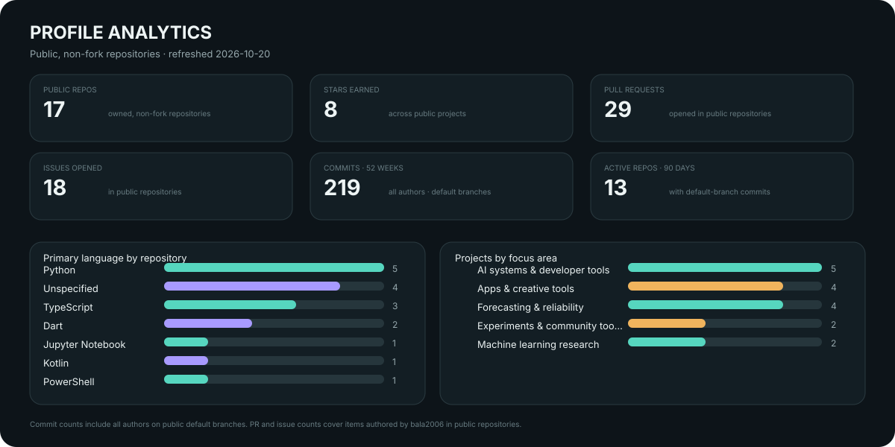
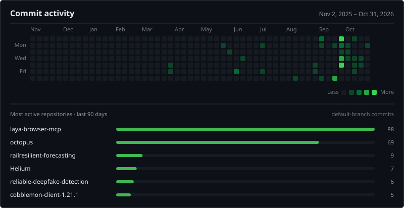

<picture>
  <source media="(max-width: 600px) and (prefers-color-scheme: light)" srcset="./assets/hero-mobile-light.svg">
  <source media="(max-width: 600px)" srcset="./assets/hero-mobile-dark.svg">
  <source media="(prefers-color-scheme: light)" srcset="./assets/hero-light.svg">
  
</picture>

I turn ambitious ideas into working software, then make the results easy to inspect.

[Selected work](#selected-work) · [At a glance](#at-a-glance) · [Activity](#commit-activity) · [Skills](#skills) · [All repositories](#all-public-repositories) · [LinkedIn](https://www.linkedin.com/in/bala-chandra-sekhar-reddy-moole/)

## Selected work

**AI systems**

- **[Nero](https://github.com/bala2006/nero)** — an on-device assistant that plans tasks, uses tools, and connects to MCP servers.
- **[Octopus](https://github.com/bala2006/octopus)** — a local-first team of AI agents that plans, builds, reviews, and tests software.

**Forecasting and research**

- **[JMA ETAS Benchmark](https://github.com/bala2006/jma-etas-benchmark)** — reproducible 72-hour probabilistic earthquake forecasts for Tohoku and Kanto.
- **[Transport Demand Forecasting](https://github.com/bala2006/transport-demand-forecasting)** — NYC taxi demand prediction with model comparisons and SHAP explanations.

**Apps and games**

- **[Helium](https://github.com/bala2006/Helium)** — an Android video editor controlled through natural-language edit instructions.
- **[Tactical Grid](https://github.com/bala2006/Tactical-Grid)** — a tower-defense game pairing a Flutter UI with a native C++ engine.

## At a glance

<picture>
  <source media="(max-width: 600px) and (prefers-color-scheme: light)" srcset="./assets/analytics/overview-mobile-light.svg">
  <source media="(max-width: 600px)" srcset="./assets/analytics/overview-mobile-dark.svg">
  <source media="(prefers-color-scheme: light)" srcset="./assets/analytics/overview-light.svg">
  
</picture>

## Commit activity

<picture>
  <source media="(max-width: 600px) and (prefers-color-scheme: light)" srcset="./assets/analytics/activity-mobile-light.svg">
  <source media="(max-width: 600px)" srcset="./assets/analytics/activity-mobile-dark.svg">
  <source media="(prefers-color-scheme: light)" srcset="./assets/analytics/activity-light.svg">
  
</picture>

Both charts are rebuilt daily from GitHub's public API. Commit counts cover default branches of public, non-fork repositories and include every author, so they differ from GitHub's personal contribution graph.

## Skills

- **Languages** — Python · TypeScript · Dart · Kotlin · C++ · PowerShell
- **Platforms and tools** — Flutter · Android · Node.js · MCP · GitHub Actions
- **Problem spaces** — AI agents · Forecasting · ML research · Mobile apps · Developer tools

## All public repositories

17 public repositories, grouped by the question each one tackles

**AI systems and developer tools**

| Project | What it explores |
| --- | --- |
| [Nero](https://github.com/bala2006/nero) | An on-device agentic assistant that plans tasks, uses tools, and connects to MCP servers. |
| [Octopus](https://github.com/bala2006/octopus) | A local-first team of AI agents that plans, builds, reviews, and tests software in a project folder. |
| [AgentMesh MCP](https://github.com/bala2006/agentmesh-mcp) | A lightweight MCP gateway for shared project context and coding-agent coordination. |
| [Laya Browser MCP](https://github.com/bala2006/laya-browser-mcp) | Browser automation with a local decision model and an MCP sampling fallback. |
| [Kiro Engineering Toolkit](https://github.com/bala2006/kiro-eng-toolkit) | Engineering tools and workflows. |

**Forecasting and reliability**

| Project | What it explores |
| --- | --- |
| [RailResilient](https://github.com/bala2006/railresilient-forecasting) | Probabilistic rail-delay forecasts when real-time feeds are missing, delayed, or unreliable. |
| [JMA ETAS Benchmark](https://github.com/bala2006/jma-etas-benchmark) | Reproducible 72-hour probabilistic earthquake forecasts for the Tohoku and Kanto region. |
| [Transport Demand Forecasting](https://github.com/bala2006/transport-demand-forecasting) | NYC taxi demand prediction, model comparisons, and SHAP explanations. |
| [Traffic Safety Reliability Benchmark](https://github.com/bala2006/traffic-safety-compute-reliability-benchmark) | How model size and compute budget affect calibrated crash-risk prediction. |

**Machine learning research**

| Project | What it explores |
| --- | --- |
| [Reliable Deepfake Detection](https://github.com/bala2006/reliable-deepfake-detection) | Experiments on generalizable deepfake detection and evidence-stability methods. |
| [Voice Detection](https://github.com/bala2006/voice-detection) | Voice detection experiments. |

**Apps and creative tools**

| Project | What it explores |
| --- | --- |
| [Helium](https://github.com/bala2006/Helium) | An Android video editor controlled through natural-language edit instructions. |
| [Tactical Grid](https://github.com/bala2006/Tactical-Grid) | A tower-defense game pairing a Flutter UI with a native C++ engine. |
| [Luna Calorie Releases](https://github.com/bala2006/luna-calorie-releases) | Release notes, news, and issue tracking for Luna Calorie. |
| [Crazy Ads](https://github.com/bala2006/crazy-ads) | A creative project space. |

**Experiments and community tools**

| Project | What it explores |
| --- | --- |
| [Laya Rail](https://github.com/bala2006/laya-rail) | An experiment in the Laya project family. |
| [Cobblemon Client](https://github.com/bala2006/cobblemon-client-1.21.1) | A verified installer for a Minecraft 1.21.1 Fabric client setup. |

## Find me

[LinkedIn](https://www.linkedin.com/in/bala-chandra-sekhar-reddy-moole/) · [All public repositories](https://github.com/bala2006?tab=repositories)
