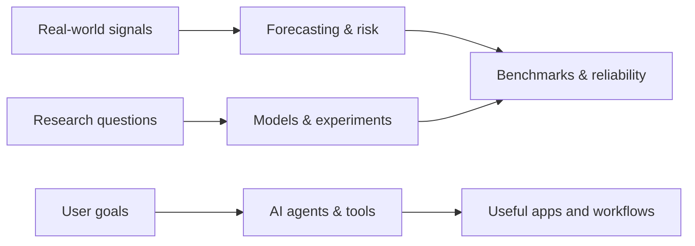

# Moole Balachandra Sekhar Reddy

### I build AI systems, practical apps, and data driven research projects.

**A map of my public work** · 17 public repositories · organized by what they explore

<picture>
  <source media="(prefers-color-scheme: light)" srcset="./assets/repo-map-light.svg">
  
</picture>

## Project map

This profile is organized by problem space, so you can quickly find the work that interests you. The map includes public repositories; repository names and descriptions below link directly to the source projects.

### AI systems & developer tools

| Project | What it explores |
| --- | --- |
| [Nero](https://github.com/bala2006/nero) | An on-device agentic assistant that plans tasks, uses tools, and connects to MCP servers. |
| [Octopus](https://github.com/bala2006/octopus) | A local-first team of AI agents that plans, builds, reviews, and tests software in a project folder. |
| [AgentMesh MCP](https://github.com/bala2006/agentmesh-mcp) | A lightweight MCP gateway for shared project context and coding-agent coordination. |
| [Laya Browser MCP](https://github.com/bala2006/laya-browser-mcp) | Browser automation with a local decision model and MCP sampling fallback. |
| [Kiro Engineering Toolkit](https://github.com/bala2006/kiro-eng-toolkit) | Engineering tools and workflows. |

### Forecasting & reliability

| Project | What it explores |
| --- | --- |
| [RailResilient](https://github.com/bala2006/railresilient-forecasting) | Probabilistic rail-delay forecasts when real-time feeds are missing, delayed, or unreliable. |
| [Transport Demand Forecasting](https://github.com/bala2006/transport-demand-forecasting) | NYC taxi demand prediction, model comparisons, and SHAP explanations. |
| [JMA ETAS Benchmark](https://github.com/bala2006/jma-etas-benchmark) | Reproducible 72-hour probabilistic earthquake forecasts for the Tohoku/Kanto region. |
| [Traffic Safety Reliability Benchmark](https://github.com/bala2006/traffic-safety-compute-reliability-benchmark) | How model size and compute affect calibrated crash-risk prediction. |

### Machine learning research

| Project | What it explores |
| --- | --- |
| [Reliable Deepfake Detection](https://github.com/bala2006/reliable-deepfake-detection) | Experiments on generalizable deepfake detection and evidence-stability methods. |
| [Voice Detection](https://github.com/bala2006/voice-detection) | Voice detection experiments. |

### Apps & creative tools

| Project | What it explores |
| --- | --- |
| [Helium](https://github.com/bala2006/Helium) | An Android video editor controlled through natural-language edit instructions. |
| [Tactical Grid](https://github.com/bala2006/Tactical-Grid) | A tower-defense game pairing Flutter UI with a native C++ engine. |
| [Luna Calorie Releases](https://github.com/bala2006/luna-calorie-releases) | Release notes, news, and issue tracking for Luna Calorie. |
| [Crazy Ads](https://github.com/bala2006/crazy-ads) | A creative project space. |

### Experiments & community tools

| Project | What it explores |
| --- | --- |
| [Laya Rail](https://github.com/bala2006/laya-rail) | An experiment in the Laya project family. |
| [Cobblemon Client](https://github.com/bala2006/cobblemon-client-1.21.1) | A verified installer for a Minecraft 1.21.1 Fabric client setup. |

## How the work connects

The diagram shows shared themes across projects, not software dependencies between repositories.

## Find me

- [LinkedIn](https://www.linkedin.com/in/bala-chandra-sekhar-reddy-moole/)
- [All public repositories](https://github.com/bala2006?tab=repositories)

*Building useful things, then making the evidence easy to inspect.*

