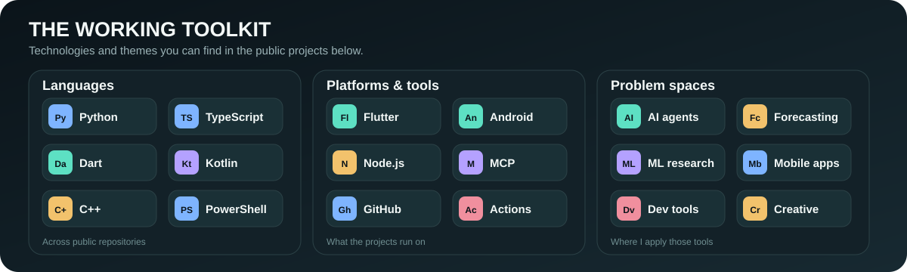
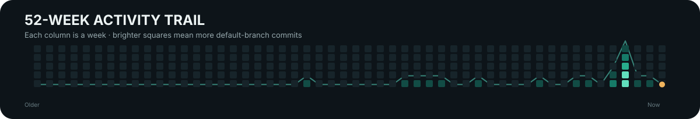
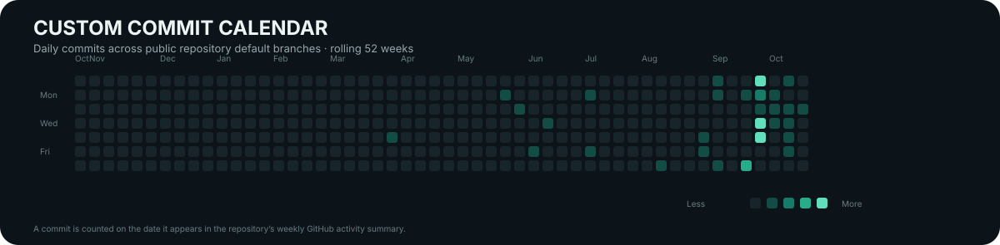
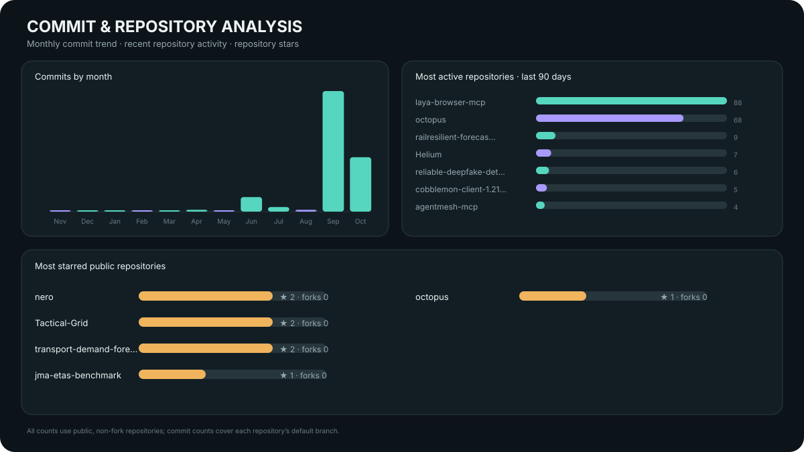
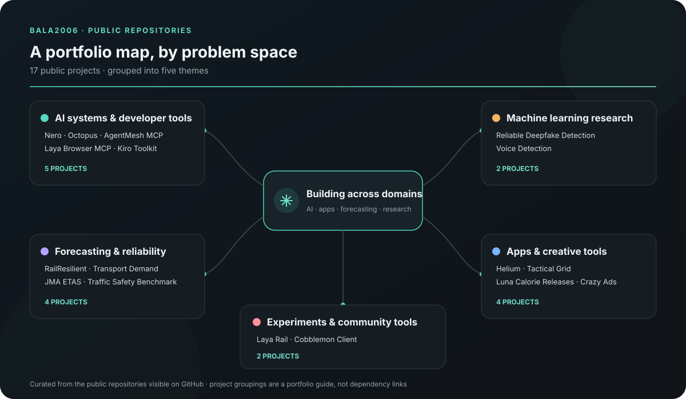

<picture>
  <source media="(max-width: 600px) and (prefers-color-scheme: light)" srcset="./assets/hero-mobile-light.svg">
  <source media="(max-width: 600px)" srcset="./assets/hero-mobile-dark.svg">
  <source media="(prefers-color-scheme: light)" srcset="./assets/hero-light.svg">
  
</picture>

 

I turn ambitious ideas into working software, then make the results easy to inspect.

[Selected work](#selected-work) · [Skills](#skills--focus) · [Activity](#activity--analysis) · [All projects](#explore-all-public-work) · [LinkedIn](https://www.linkedin.com/in/bala-chandra-sekhar-reddy-moole/)

## At a glance

An overview of my public, non-fork repositories. The charts update daily.

<picture>
  <source media="(max-width: 600px) and (prefers-color-scheme: light)" srcset="./assets/analytics/overview-mobile-light.svg">
  <source media="(max-width: 600px)" srcset="./assets/analytics/overview-mobile-dark.svg">
  <source media="(prefers-color-scheme: light)" srcset="./assets/analytics/overview-light.svg">
  
</picture>

## Skills & focus

The technologies and problem spaces visible across my public projects.

<picture>
  <source media="(max-width: 600px) and (prefers-color-scheme: light)" srcset="./assets/skills-mobile-light.svg">
  <source media="(max-width: 600px)" srcset="./assets/skills-mobile-dark.svg">
  <source media="(prefers-color-scheme: light)" srcset="./assets/skills-light.svg">
  
</picture>

## Selected work

Start here for a quick view of what I build.

### AI systems

- **[Nero](https://github.com/bala2006/nero)** — An on-device assistant that plans tasks, uses tools, and connects to MCP servers.
- **[Octopus](https://github.com/bala2006/octopus)** — A local-first team of AI agents that plans, builds, reviews, and tests software.

### Forecasting & research

- **[Transport Demand Forecasting](https://github.com/bala2006/transport-demand-forecasting)** — NYC taxi demand prediction, model comparisons, and SHAP explanations.
- **[JMA ETAS Benchmark](https://github.com/bala2006/jma-etas-benchmark)** — Reproducible 72-hour probabilistic earthquake forecasts for Tohoku and Kanto.

### Apps & games

- **[Helium](https://github.com/bala2006/Helium)** — An Android video editor controlled through natural-language edit instructions.
- **[Tactical Grid](https://github.com/bala2006/Tactical-Grid)** — A tower-defense game pairing Flutter UI with a native C++ engine.

## Activity & analysis

The activity strip, calendar, and charts refresh daily from GitHub's public repository data.

<picture>
  <source media="(max-width: 600px) and (prefers-color-scheme: light)" srcset="./assets/analytics/activity-strip-mobile-light.svg">
  <source media="(max-width: 600px)" srcset="./assets/analytics/activity-strip-mobile-dark.svg">
  <source media="(prefers-color-scheme: light)" srcset="./assets/analytics/activity-strip-light.svg">
  
</picture>

<picture>
  <source media="(max-width: 600px) and (prefers-color-scheme: light)" srcset="./assets/analytics/commit-calendar-mobile-light.svg">
  <source media="(max-width: 600px)" srcset="./assets/analytics/commit-calendar-mobile-dark.svg">
  <source media="(prefers-color-scheme: light)" srcset="./assets/analytics/commit-calendar-light.svg">
  
</picture>

<picture>
  <source media="(max-width: 600px) and (prefers-color-scheme: light)" srcset="./assets/analytics/commit-analysis-mobile-light.svg">
  <source media="(max-width: 600px)" srcset="./assets/analytics/commit-analysis-mobile-dark.svg">
  <source media="(prefers-color-scheme: light)" srcset="./assets/analytics/commit-analysis-light.svg">
  
</picture>

*Commit counts cover public repositories' default branches and include all authors. Private repositories and forks are excluded. They will differ from GitHub's personal contribution count.*

## Explore all public work

This map groups projects by the questions they tackle. The full index below links to every public project in the map.

<picture>
  <source media="(max-width: 600px) and (prefers-color-scheme: light)" srcset="./assets/repo-map-mobile-light.svg">
  <source media="(max-width: 600px)" srcset="./assets/repo-map-mobile-dark.svg">
  <source media="(prefers-color-scheme: light)" srcset="./assets/repo-map-light.svg">
  
</picture>

<strong>Browse the full repository index by area</strong>

### AI systems & developer tools

| Project | What it explores |
| --- | --- |
| [Nero](https://github.com/bala2006/nero) | An on-device agentic assistant that plans tasks, uses tools, and connects to MCP servers. |
| [Octopus](https://github.com/bala2006/octopus) | A local-first team of AI agents that plans, builds, reviews, and tests software in a project folder. |
| [AgentMesh MCP](https://github.com/bala2006/agentmesh-mcp) | A lightweight MCP gateway for shared project context and coding-agent coordination. |
| [Laya Browser MCP](https://github.com/bala2006/laya-browser-mcp) | Browser automation with a local decision model and MCP sampling fallback. |
| [Kiro Engineering Toolkit](https://github.com/bala2006/kiro-eng-toolkit) | Engineering tools and workflows. |

### Forecasting & reliability

| Project | What it explores |
| --- | --- |
| [RailResilient](https://github.com/bala2006/railresilient-forecasting) | Probabilistic rail-delay forecasts when real-time feeds are missing, delayed, or unreliable. |
| [Transport Demand Forecasting](https://github.com/bala2006/transport-demand-forecasting) | NYC taxi demand prediction, model comparisons, and SHAP explanations. |
| [JMA ETAS Benchmark](https://github.com/bala2006/jma-etas-benchmark) | Reproducible 72-hour probabilistic earthquake forecasts for the Tohoku/Kanto region. |
| [Traffic Safety Reliability Benchmark](https://github.com/bala2006/traffic-safety-compute-reliability-benchmark) | How model size and compute affect calibrated crash-risk prediction. |

### Machine learning research

| Project | What it explores |
| --- | --- |
| [Reliable Deepfake Detection](https://github.com/bala2006/reliable-deepfake-detection) | Experiments on generalizable deepfake detection and evidence-stability methods. |
| [Voice Detection](https://github.com/bala2006/voice-detection) | Voice detection experiments. |

### Apps & creative tools

| Project | What it explores |
| --- | --- |
| [Helium](https://github.com/bala2006/Helium) | An Android video editor controlled through natural-language edit instructions. |
| [Tactical Grid](https://github.com/bala2006/Tactical-Grid) | A tower-defense game pairing Flutter UI with a native C++ engine. |
| [Luna Calorie Releases](https://github.com/bala2006/luna-calorie-releases) | Release notes, news, and issue tracking for Luna Calorie. |
| [Crazy Ads](https://github.com/bala2006/crazy-ads) | A creative project space. |

### Experiments & community tools

| Project | What it explores |
| --- | --- |
| [Laya Rail](https://github.com/bala2006/laya-rail) | An experiment in the Laya project family. |
| [Cobblemon Client](https://github.com/bala2006/cobblemon-client-1.21.1) | A verified installer for a Minecraft 1.21.1 Fabric client setup. |

## Find me

[LinkedIn](https://www.linkedin.com/in/bala-chandra-sekhar-reddy-moole/) · [All public repositories](https://github.com/bala2006?tab=repositories)

